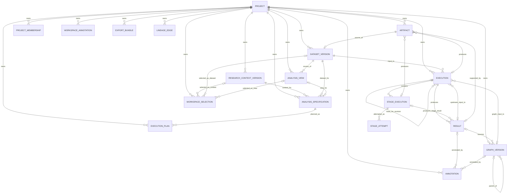

# 21_01_entity_relationships

**Status:** `RD02_STRUCTURAL_WORKING_COPY / E11_NOT_PUBLISHED`; original ID, level and state retained.  
**Source blob:** `72903b9ad48b5b7edabaa7bb1c2cace42aa46ce7`.

---

## 2. Entity関係

本章は`1.3.1 Domain Resource`として分類したpersistent Entity間のownership / reference / cardinality / deletion semanticsを定義する。`1.3.2 Domain Resource外の論理概念`の関係はpersistent ERへ混在させず、`## 4. 非Entityのデータモデル`で定義する。

### 2.1 ER図



`WorkspaceAnnotation.target_id`、`LineageEdge.source_id / target_id`、`ExportBundle.result_ids_json`はpolymorphic / collection referenceであるため、ER図では固定FK edgeとして展開しない。

### 2.2 Cardinality一覧

| 関係 | Cardinality | 説明 |
| --- | --- | --- |
| Project - Artifact | 1 : 0..N | Projectは複数Artifactを所有する |
| Project - DatasetVersion | 1 : 0..N | Projectは複数DatasetVersionを所有する |
| Project - ResearchContextVersion | 1 : 0..N | Projectは複数ResearchContextVersionを所有する |
| Project - AnalysisView | 1 : 0..N | Projectは複数AnalysisViewを所有する |
| Project - AnalysisSpecification | 1 : 0..N | Projectは複数AnalysisSpecificationを所有する |
| Project - ExecutionPlan | 1 : 0..N | Projectは複数ExecutionPlanを所有する |
| Project - Execution | 1 : 0..N | Projectは複数Executionを所有する |
| Project - GraphVersion | 1 : 0..N | Projectは複数GraphVersionを所有する |
| Project - Annotation | 1 : 0..N | Projectは複数Annotationを所有する |
| Project - ProjectMembership | 1 : 0..N | Projectは複数user roleを持つ |
| Project - WorkspaceSelection | 1 : 0..N | Projectはuserごとのselectionを持つ |
| Project - WorkspaceAnnotation | 1 : 0..N | Projectは複数WorkspaceAnnotationを持つ |
| Project - ExportBundle | 1 : 0..N | Projectは複数ExportBundleを持つ |
| Project - LineageEdge | 1 : 0..N | Projectは複数LineageEdgeを持つ |
| Artifact - DatasetVersion | 1 : 0..1 | DatasetVersionは1つのSOURCE Artifactを参照し、source Artifactは1つのDatasetVersionに対応する |
| DatasetVersion - AnalysisView | 1 : 0..N | 一つのDatasetVersionから複数AnalysisViewを作成できる |
| ResearchContextVersion - AnalysisSpecification | 1 : 0..N | Context Versionを複数Specificationが参照できる |
| DatasetVersion - AnalysisSpecification | 1 : 0..N | DatasetVersionを複数Specificationが参照できる |
| AnalysisView - AnalysisSpecification | 0..1 : 0..N | SpecificationはAnalysisViewを任意参照する |
| AnalysisSpecification - ExecutionPlan | 1 : 0..N | 同一Specificationからplanner/version違いのPlanを生成し得る |
| DatasetVersion - Execution | 1 : 0..N | DatasetVersionを複数Executionが使用できる |
| GraphVersion - Execution | 0..1 : 0..N | Operationに応じて入力Graphを使用する |
| Result - Execution | 0..1 : 0..N | Operationに応じて上流Resultを明示参照する |
| Execution - Execution | 0..1 : 0..N | rerun/revision Executionはbase Executionを任意参照する |
| Execution - StageExecution | 1 : 0..N | Executionはruntime StageExecutionを持つ |
| StageExecution - StageAttempt | 1 : 0..N | StageExecutionは複数attemptを持つ |
| Execution - Result | 1 : 0..N | Executionは複数Resultを生成できる |
| StageExecution - Result | 0..1 : 0..N | STAGE_RESULTは1つのStageExecutionへ所属する |
| Execution - Artifact | 0..1 : 0..N | EXECUTION_OUTPUT ArtifactはExecutionへ所属する |
| StageExecution - Artifact | 0..1 : 0..N | Artifactは生成Stageを任意に指示できる |
| Result - Artifact | 0..1 : 0..N | Artifactは対応Resultを任意参照できる |
| Result - GraphVersion | 0..1 : 0..N | GraphVersionはsource Resultを任意参照する |
| GraphVersion - GraphVersion | 0..1 : 0..N | 編集・派生GraphVersionは親GraphVersionを任意参照する |
| Result - Annotation | 0..1 : 0..N | AnnotationはResultを対象にできる |
| GraphVersion - Annotation | 0..1 : 0..N | AnnotationはGraphVersionを対象にできる |
| ResearchContextVersion - WorkspaceSelection | 0..1 : 0..N | user selectionがActive Research Contextを任意参照する |
| DatasetVersion - WorkspaceSelection | 0..1 : 0..N | user selectionがDatasetVersionを任意参照する |
| AnalysisView - WorkspaceSelection | 0..1 : 0..N | user selectionがAnalysisViewを任意参照する |

### 2.3 参照・削除方針

- Project、ResearchContextVersion、DatasetVersion、AnalysisView、AnalysisSpecification、ExecutionPlan、Execution、StageExecution、StageAttempt、Result、Artifact、GraphVersionおよびLineageEdgeは分析来歴・再現性の構成要素であるため、参照が存在する状態でのhard deleteを禁止する。
- Projectの利用停止は`ARCHIVED`で表現し、Project配下Resourceをcascade deleteしない。
- FK削除動作は原則`RESTRICT`とする。
- immutable / FIXED Resourceの内容変更は既存rowの更新ではなく新Version / 新Execution / 新Result等として表現する。
- Artifactの物理binary削除は、論理metadata・Lineageの保持要件とretention policyを満たし、参照がない場合にのみ許容する。Artifact metadataをLineageから先に破壊してはならない。
- `WorkspaceSelection`はmutable operational stateであり削除・再作成可能だが、選択対象Entityを削除する根拠にはならない。
- `Annotation` / `WorkspaceAnnotation`の変更履歴要件はそれぞれのmodelに従う。scientific decisionの監査性が必要な場合、過去意味を破壊するhard deleteは行わない。
- polymorphic reference（WorkspaceAnnotation / LineageEdge）はApplication validationでtarget existenceとProject境界を保証する。
- Compatibility read modelの保持・廃止はmigration policyに従うが、canonical Entityを参照している間は破壊的削除を行わない。

### 2.4 Domain Resource関係モデル

`2.1`〜`2.3`はpersistent Entity間の関係をER / cardinality / deletion policyとして厳密に定義する。本節は、それらを読者が俯瞰しやすいownership / reference modelとして再表現する。

#### 2.4.1 Ownership / lifecycleの俯瞰

```text
Project
├── Artifact
├── DatasetVersion
│   └── AnalysisView
├── ResearchContextVersion
├── AnalysisSpecification
│   └── ExecutionPlan
├── Execution
│   ├── StageExecution
│   │   └── StageAttempt
│   ├── Result
│   └── Artifact (EXECUTION_OUTPUT)
├── GraphVersion
├── Annotation
├── ProjectMembership
├── WorkspaceSelection
├── WorkspaceAnnotation
├── ExportBundle
└── LineageEdge
```

このtreeはownership / lifecycle上の主要な包含関係を示すための論理俯瞰であり、すべてのFKをtree edgeとして表現するものではない。cross-referenceは次節および`2.1 ER図`を正本とする。

#### 2.4.2 主要参照

```text
DatasetVersion.source_artifact_id -> Artifact(SOURCE)
AnalysisView -> DatasetVersion
AnalysisSpecification -> ResearchContextVersion
AnalysisSpecification -> DatasetVersion
AnalysisSpecification -> optional AnalysisView
ExecutionPlan.analysis_specification_id -> AnalysisSpecification identity
Execution -> DatasetVersion
Execution -> optional GraphVersion / upstream Result
Execution -> optional base Execution
StageExecution -> Execution
StageAttempt -> StageExecution
Result -> Execution
STAGE_RESULT -> StageExecution
Artifact(EXECUTION_OUTPUT) -> Execution; optional StageExecution / Result
GraphVersion -> optional Result / parent GraphVersion
Annotation -> exactly one of Result / GraphVersion
WorkspaceSelection -> optional ResearchContextVersion / DatasetVersion / AnalysisView
WorkspaceAnnotation -> Project-scoped target Resource
ExportBundle -> Result collection
LineageEdge -> same-Project source / target
```

#### 2.4.3 Current implementation / canonical authority boundary

- Canonical `Execution`に`execution_plan_id`を独立FK / logical attributeとして必須化しない。ExecutionPlan identityを保持するapplication pathでは`analysis_spec_json`内metadataとして扱い得るが、canonical Execution FKと同一視しない。
- `FamilyExecution / FamilyStageExecution / FamilyResult / FamilyArtifact`はhistorical / compatibility read modelであり、新規canonical lifecycle write authorityではない。
- `WorkspaceAnnotation.target_id`、`LineageEdge.source_id / target_id`、`ExportBundle.result_ids_json`はpolymorphic / collection referenceであり、固定FKだけで全関係を表現しない。Application validationでtarget existenceとProject boundaryを保証する。
- `AnalysisFamily`はDomain Resourceではないが、`AnalysisSpecification.analysis_family`、`ExecutionPlan.analysis_family`、`Execution.analysis_family`の共通discriminatorとして現れる。duplicate Family discriminatorを追加しない。
- `FamilyNavigationDescriptor -> NavigationStageDescriptor -> renderer / use-case binding`の関係はapplication metadata relationであり、persistent ER relationへ変換しない。詳細は`4.3 Navigation metadata model`を正本とする。
