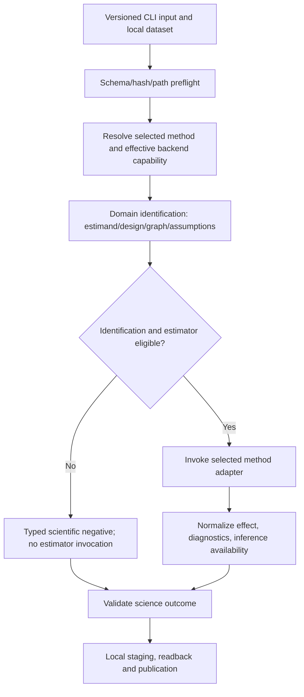

# 22_04_workflow_core

**Status:** `BD01_E11_BASIC_DESIGN_REVISED / OWNER_POLICY_APPROVED / INDEPENDENT_REVIEW_PENDING`. Original chapter and source provenance retained; DD physical coverage remains partial.  
**Source blob:** `87196f2f03a7f3367724bc05fb254d1a4d98109e`.

---

## 9. Generic Workflow Core

### 9.1 Planner

`PlannerRegistry`はAnalysis FamilyとSpecification Schema VersionからPlannerを解決する。

```text
AnalysisSpecification
  ↓
PlannerRegistry.resolve(family, schema_version)
  ↓
Family Planner
  ↓
ExecutionPlan
```

PlannerはDomain上のruntime planを生成し、browser navigation stateを入力として要求しない。

### 9.2 Plan

Execution Planはruntime Stage DAGである。

- Stage keyはPlan内一意。
- Stage Typeはruntime operation identityを表す。
- Edgeはoutput / input bindingを表す。
- cycle禁止。
- required input未解決禁止。
- Runner未登録禁止。

Navigation Stageのsidebar orderをExecution Plan dependencyへ変換しない。

### 9.3 Executor

Generic Executorはcanonical lifecycle/application serviceが所有するworkflow execution context内で、Analysis内容を知らずにruntime Stageを実行する。

1. dependency解決
2. runtime Stage sequencing
3. Runner解決・invocation
4. workflow-level validation
5. temporary output binding

canonical Execution lifecycleはNavigation改修の対象外とし、current contractを維持する。基本設計上の境界は次のとおり。

- Execution technical statusは`QUEUED / RUNNING / SUCCEEDED / FAILED / CANCELLED`で管理する。
- Worker ownershipは`Execution.lease_owner / lease_expires_at`とrepository-level claim / renew / completeで管理し、Navigation stateをclaim条件へ追加しない。
- retry/rerun/reviseはcanonical Execution / revision semanticsとして扱い、Navigation Stage遷移へ変換しない。
- runtime Stageの進行は`StageExecution`とappend-only `StageAttempt`で表現する。
- Result / Artifactはcanonical Execution / StageExecution ownershipから生成・永続化し、browser routeやCurrent Navigation Stageをpersistent ownership fieldへ追加しない。
- transaction境界とpersistent lifecycle authorityはproduct application / persistence側に残し、Navigation componentへ移さない。

### 9.4 Runner Registry

runtime Runner Registryは`StageType`によりrunnerを解決する。

Navigation Stage IDを`StageType`として登録しない。巨大な`if navigation_stage == ...`をExecutorへ追加しない。

### 9.5 Navigation Stageとの境界

次を禁止する。

- `NavigationStageDescriptor`を`StageDefinition` / `StageExecution`のsubtypeにする。
- Navigation Stage IDをruntime `StageType`へ流用する。
- `AnalysisSpecification.navigation_stage`をexecution prerequisiteとして追加する。
- runtime moduleからbrowser route / Navigation Stage moduleへ依存する。

#### 9.5.1 Distribution

`Exploratory / Distribution`がDataset/profile/resultのreadだけで成立する場合、対応するruntime Execution Stageを作らない。

#### 9.5.2 Metrics

`Predictive / Metrics`は既存evaluation Resultを読むだけで成立してよい。Navigation taxonomyを理由に`METRICS` runtime Stageを新設しない。

#### 9.5.3 Explainability

1 Navigation Stageから複数read/compute use caseを呼び出してよい。Navigation StageとExecution Stageのcardinalityを1:1へ固定しない。

### 9.6 CLI / Library independence

CLI / Python library / backend use caseは、Analysis Specificationまたは既存use-case inputだけでexecutionを開始できる。

`Current Navigation Stage`、browser route、sidebar stateをrequired inputへ追加しない。


### 9.7. Local Scientific Use Caseの実行制御



- **Malformed/unsafe input** はpreflightで拒否し、科学的な非識別とは区別する。
- **未識別・Review要・Estimator非適格**なら選択Estimatorを呼ばず、原因・仮定・入力/Graph参照を保持したscientific negativeを表現する。旧v2のoverrideを新E11へ暗黙継承しない。
- **Backend不在**は`METHOD_UNAVAILABLE`相当のCapability結果として扱う（具体codeはIF-01）。要求されたMethodを他Estimatorで代替して成功扱いしない。
- 点推定可能でも、**Confirmatory**で妥当な推論が無い場合はScience PASSではない。Exploratoryのpoint-onlyと区別する。
- Scientific negativeの正常記録と、I/O／計算／validationの技術障害は別の軸。Publish可否を`Execution success`という1つのbooleanに押し込めない。

**Product workflowとの相違:** 上記のpreflight→identification→eligibility→estimationの論理手順はProductのStage DAG／Worker lifecycle／`StageExecution`増設ではない。既存ProductのPlanner・Runnerと、Local CLIのscientific orchestrationは異なる実行authorityである。

## 98. RD-04：要件由来の基本設計制約

**Status:** `RD04_DESIGN_MIGRATED / OWNER_CONTENT_REVIEW_PENDING`。要件文の抽象化・設計移管で失われてはならない元の実現方式・責務境界を保持する。旧Requirement IDとStatusを維持する。コード検証やArchitecture GateのPASSを意味しない。

### 98.1. FR-075（MOVE_BD）

- 既存要件の設計情報を含む原文：Family別PlannerをRegistryから解決する
- RDに残る能力／Legacy Trace：【設計制約移管・Legacy Trace】NFR-005の実現に係る既存設計制約。具体的な実装契約は下位設計とRD-04移管台帳で管理し、元ID・MUST・Statusの追跡を維持する
- Original Requirement：`FR-075`; Status：`ACTIVE`; Implementation：`IMPLEMENTED`; [RD-04逐条台帳](../95_rd04_fr_application_review.md)

### 98.2. FR-076（SPLIT）

- 既存要件の設計情報を含む原文：Plannerはversionedで不変なExecution Planを生成する
- RDに残る能力／Legacy Trace：分析の実行計画を版管理し、実行時の条件を後から復元できる
- Original Requirement：`FR-076`; Status：`ACTIVE`; Implementation：`IMPLEMENTED`; [RD-04逐条台帳](../95_rd04_fr_application_review.md)

### 98.3. FR-077（MOVE_BD）

- 既存要件の設計情報を含む原文：Stage Typeをnamespace、name、versionで識別する
- RDに残る能力／Legacy Trace：【設計制約移管・Legacy Trace】FR-076の実現に係る既存設計制約。具体的な実装契約は下位設計とRD-04移管台帳で管理し、元ID・MUST・Statusの追跡を維持する
- Original Requirement：`FR-077`; Status：`ACTIVE`; Implementation：`IMPLEMENTED`; [RD-04逐条台帳](../95_rd04_fr_application_review.md)

### 98.4. FR-078（SPLIT）

- 既存要件の設計情報を含む原文：PlanはStage dependencyとinput/output bindingをDAGとして保持する
- RDに残る能力／Legacy Trace：分析処理の依存順序と処理間の入力・出力の対応を追跡できる
- Original Requirement：`FR-078`; Status：`ACTIVE`; Implementation：`IMPLEMENTED`; [RD-04逐条台帳](../95_rd04_fr_application_review.md)

### 98.5. FR-079（MOVE_BD）

- 既存要件の設計情報を含む原文：Stage RunnerをRegistryから解決し、Executorへif/elif分岐を集約しない
- RDに残る能力／Legacy Trace：【設計制約移管・Legacy Trace】NFR-005の実現に係る既存設計制約。具体的な実装契約は下位設計とRD-04移管台帳で管理し、元ID・MUST・Statusの追跡を維持する
- Original Requirement：`FR-079`; Status：`ACTIVE`; Implementation：`IMPLEMENTED`; [RD-04逐条台帳](../95_rd04_fr_application_review.md)

### 98.6. FR-080（MOVE_BD）

- 既存要件の設計情報を含む原文：canonical lifecycle/application serviceがExecutionのclaim、state、cancel、retry、Result/Artifact metadata commitを所有し、Generic Executorはowned workflow context内で依存順、Stage sequencing、runner invocationを実行する
- RDに残る能力／Legacy Trace：【設計制約移管・Legacy Trace】FR-081の実現に係る既存設計制約。具体的な実装契約は下位設計とRD-04移管台帳で管理し、元ID・MUST・Statusの追跡を維持する
- Original Requirement：`FR-080`; Status：`ACTIVE`; Implementation：`IMPLEMENTED`; [RD-04逐条台帳](../95_rd04_fr_application_review.md)

### 98.7. FR-082（SPLIT）

- 既存要件の設計情報を含む原文：idempotency対象Commandでは`(project_id, command_scope, idempotency_key)`をauthorityとし、同一semantic requestをreplay、異なるrequestを`IDEMPOTENCY_CONFLICT`で拒否する
- RDに残る能力／Legacy Trace：再送された同一依頼の重複処理を防止し、同じ識別子で異なる依頼が来た場合は拒否する
- Original Requirement：`FR-082`; Status：`ACTIVE`; Implementation：`IMPLEMENTED`; [RD-04逐条台帳](../95_rd04_fr_application_review.md)

### 98.8. FR-084（SPLIT）

- 既存要件の設計情報を含む原文：上流Artifactを下流Stage inputへ型付きでbindingする
- RDに残る能力／Legacy Trace：依存処理の成果物を適切な形式で後続処理に引き渡せる
- Original Requirement：`FR-084`; Status：`ACTIVE`; Implementation：`IMPLEMENTED`; [RD-04逐条台帳](../95_rd04_fr_application_review.md)

### 98.9. FR-086b（SPLIT）

- 既存要件の設計情報を含む原文：Stageごとのtimeout / operational resource limitをpersistent/configurable policyとして保持する
- RDに残る能力／Legacy Trace：処理ごとの時間・資源上限を設定できる
- Original Requirement：`FR-086b`; Status：`DEFERRED`; Implementation：`PARTIAL`; [RD-04逐条台帳](../95_rd04_fr_application_review.md)

### 98.10. FR-128a（MOVE_BD）

- 既存要件の設計情報を含む原文：Algorithm/Runnerをregistry/capabilityから解決・管理するcurrent contractを維持する
- RDに残る能力／Legacy Trace：【設計制約移管・Legacy Trace】FR-035／NFR-005の実現に係る既存設計制約。具体的な実装契約は下位設計とRD-04移管台帳で管理し、元ID・MUST・Statusの追跡を維持する
- Original Requirement：`FR-128a`; Status：`ACTIVE`; Implementation：`IMPLEMENTED`; [RD-04逐条台帳](../95_rd04_fr_application_review.md)

### 98.11. NFR-003（SPLIT）

- 既存要件の設計情報を含む原文：Canonical JSONとhash生成はfield順やprocessに依存しない
- RDに残る能力／Legacy Trace：同一内容から環境に依存しない同一性識別値を生成できる
- Original Requirement：`NFR-003`; Status：`ACTIVE`; Implementation：`IMPLEMENTED`; [RD-04逐条台帳](../96_rd04_nfr_ar_application_review.md)

### 98.12. NFR-005（SPLIT）

- 既存要件の設計情報を含む原文：新Analysis Familyを既存Executor変更なしにRegistry追加できる
- RDに残る能力／Legacy Trace：新しい分析領域を既存分析の挙動を壊さず追加できる
- Original Requirement：`NFR-005`; Status：`ACTIVE`; Implementation：`IMPLEMENTED`; [RD-04逐条台帳](../96_rd04_nfr_ar_application_review.md)

### 98.13. NFR-006a（SPLIT）

- 既存要件の設計情報を含む原文：current claim/lease/retry mechanicsでExecution/Stage lifecycleを安全に再試行できる
- RDに残る能力／Legacy Trace：中断・再送時にExecutionを安全に再開・再試行できる
- Original Requirement：`NFR-006a`; Status：`ACTIVE`; Implementation：`IMPLEMENTED`; [RD-04逐条台帳](../96_rd04_nfr_ar_application_review.md)

### 98.14. NFR-006b（SPLIT）

- 既存要件の設計情報を含む原文：retry/restartでsuccessful Stage outputのduplicate durable Artifact materializationを防止する。exactly-once executionは保証しない
- RDに残る能力／Legacy Trace：再試行・再起動で成功済み成果物の重複作成を防止する
- Original Requirement：`NFR-006b`; Status：`ACTIVE`; Implementation：`PARTIAL`; [RD-04逐条台帳](../96_rd04_nfr_ar_application_review.md)
