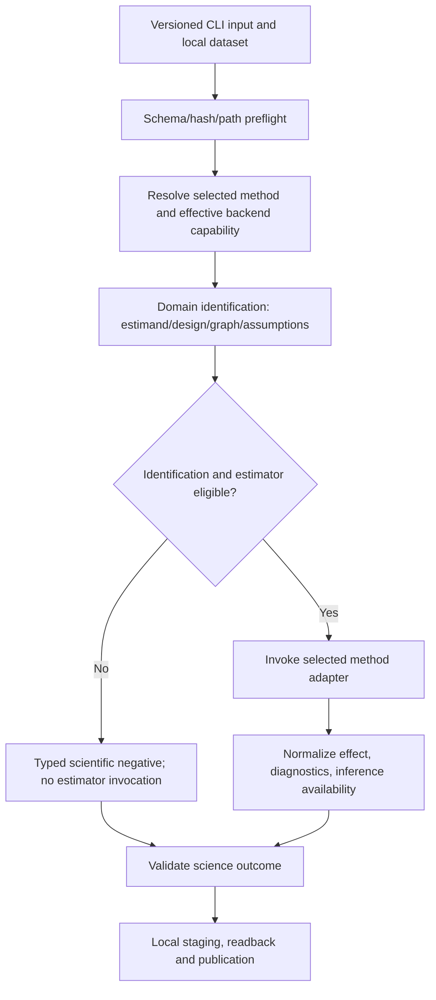

# 22_04_workflow_core

**Status:** `BD01_E11_BASIC_DESIGN_REVISED / OWNER_POLICY_APPROVED / INDEPENDENT_REVIEW_PENDING`. Original chapter and source provenance retained; DD physical coverage remains partial.  
**Source blob:** `87196f2f03a7f3367724bc05fb254d1a4d98109e`.

---

## 9. Generic Workflow Core

### 9.1 Planner

`PlannerRegistry`はAnalysis FamilyとSpecification Schema VersionからPlannerを解決する。

```text
AnalysisSpecification
  ↓
PlannerRegistry.resolve(family, schema_version)
  ↓
Family Planner
  ↓
ExecutionPlan
```

PlannerはDomain上のruntime planを生成し、browser navigation stateを入力として要求しない。

### 9.2 Plan

Execution Planはruntime Stage DAGである。

- Stage keyはPlan内一意。
- Stage Typeはruntime operation identityを表す。
- Edgeはoutput / input bindingを表す。
- cycle禁止。
- required input未解決禁止。
- Runner未登録禁止。

Navigation Stageのsidebar orderをExecution Plan dependencyへ変換しない。

### 9.3 Executor

Generic Executorはcanonical lifecycle/application serviceが所有するworkflow execution context内で、Analysis内容を知らずにruntime Stageを実行する。

1. dependency解決
2. runtime Stage sequencing
3. Runner解決・invocation
4. workflow-level validation
5. temporary output binding

canonical Execution lifecycleはNavigation改修の対象外とし、current contractを維持する。基本設計上の境界は次のとおり。

- Execution technical statusは`QUEUED / RUNNING / SUCCEEDED / FAILED / CANCELLED`で管理する。
- Worker ownershipは`Execution.lease_owner / lease_expires_at`とrepository-level claim / renew / completeで管理し、Navigation stateをclaim条件へ追加しない。
- retry/rerun/reviseはcanonical Execution / revision semanticsとして扱い、Navigation Stage遷移へ変換しない。
- runtime Stageの進行は`StageExecution`とappend-only `StageAttempt`で表現する。
- Result / Artifactはcanonical Execution / StageExecution ownershipから生成・永続化し、browser routeやCurrent Navigation Stageをpersistent ownership fieldへ追加しない。
- transaction境界とpersistent lifecycle authorityはproduct application / persistence側に残し、Navigation componentへ移さない。

### 9.4 Runner Registry

runtime Runner Registryは`StageType`によりrunnerを解決する。

Navigation Stage IDを`StageType`として登録しない。巨大な`if navigation_stage == ...`をExecutorへ追加しない。

### 9.5 Navigation Stageとの境界

次を禁止する。

- `NavigationStageDescriptor`を`StageDefinition` / `StageExecution`のsubtypeにする。
- Navigation Stage IDをruntime `StageType`へ流用する。
- `AnalysisSpecification.navigation_stage`をexecution prerequisiteとして追加する。
- runtime moduleからbrowser route / Navigation Stage moduleへ依存する。

#### 9.5.1 Distribution

`Exploratory / Distribution`がDataset/profile/resultのreadだけで成立する場合、対応するruntime Execution Stageを作らない。

#### 9.5.2 Metrics

`Predictive / Metrics`は既存evaluation Resultを読むだけで成立してよい。Navigation taxonomyを理由に`METRICS` runtime Stageを新設しない。

#### 9.5.3 Explainability

1 Navigation Stageから複数read/compute use caseを呼び出してよい。Navigation StageとExecution Stageのcardinalityを1:1へ固定しない。

### 9.6 CLI / Library independence

CLI / Python library / backend use caseは、Analysis Specificationまたは既存use-case inputだけでexecutionを開始できる。

`Current Navigation Stage`、browser route、sidebar stateをrequired inputへ追加しない。


### 9.7. Local Scientific Use Caseの実行制御



- **Malformed/unsafe input** はpreflightで拒否し、科学的な非識別とは区別する。
- **未識別・Review要・Estimator非適格**なら選択Estimatorを呼ばず、原因・仮定・入力/Graph参照を保持したscientific negativeを表現する。旧v2のoverrideを新E11へ暗黙継承しない。
- **Backend不在**は`METHOD_UNAVAILABLE`相当のCapability結果として扱う（具体codeはIF-01）。要求されたMethodを他Estimatorで代替して成功扱いしない。
- 点推定可能でも、**Confirmatory**で妥当な推論が無い場合はScience PASSではない。Exploratoryのpoint-onlyと区別する。
- Scientific negativeの正常記録と、I/O／計算／validationの技術障害は別の軸。Publish可否を`Execution success`という1つのbooleanに押し込めない。

**Product workflowとの相違:** 上記のpreflight→identification→eligibility→estimationの論理手順はProductのStage DAG／Worker lifecycle／`StageExecution`増設ではない。既存ProductのPlanner・Runnerと、Local CLIのscientific orchestrationは異なる実行authorityである。

**当該機能に適用する設計制約（関連Requirement）**

- **`FR-075`**：Family別PlannerをRegistryから解決する
- **`FR-076`**：Plannerはversionedで不変なExecution Planを生成する
- **`FR-077`**：Stage Typeをnamespace、name、versionで識別する
- **`FR-078`**：PlanはStage dependencyとinput/output bindingをDAGとして保持する
- **`FR-079`**：Stage RunnerをRegistryから解決し、Executorへif/elif分岐を集約しない
- **`FR-080`**：canonical lifecycle/application serviceがExecutionのclaim、state、cancel、retry、Result/Artifact metadata commitを所有し、Generic Executorはowned workflow context内で依存順、Stage sequencing、runner invocationを実行する
- **`FR-082`**：idempotency対象Commandでは`(project_id, command_scope, idempotency_key)`をauthorityとし、同一semantic requestをreplay、異なるrequestを`IDEMPOTENCY_CONFLICT`で拒否する
- **`FR-084`**：上流Artifactを下流Stage inputへ型付きでbindingする
- **`FR-086b`（将来拡張・現行提供対象外）**：Stageごとのtimeout / operational resource limitをpersistent/configurable policyとして保持する
- **`FR-128a`**：Algorithm/Runnerをregistry/capabilityから解決・管理するcurrent contractを維持する
- **`NFR-003`**：Canonical JSONとhash生成はfield順やprocessに依存しない
- **`NFR-005`**：新Analysis Familyを既存Executor変更なしにRegistry追加できる
- **`NFR-006a`**：current claim/lease/retry mechanicsでExecution/Stage lifecycleを安全に再試行できる
- **`NFR-006b`**：retry/restartでsuccessful Stage outputのduplicate durable Artifact materializationを防止する。exactly-once executionは保証しない
