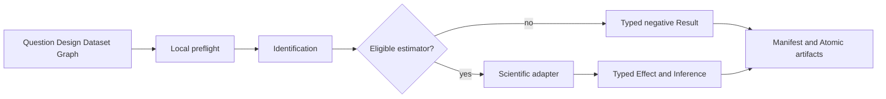

# ENH-E11 — Causal CLI Basic Design (BD)

**文書状態:** `WORKING_DRAFT / OWNER_SEMANTIC_POLICY_APPROVED / FORMAL_PUBLICATION_PENDING`. 本文の仮ID・候補Schema/Port/classは正式なFR/NFR/AR、ADR、Gate Freezeではない。Owner決定DEC01〜09を変更せず詳細化する。

## 1. System boundary and responsibilities

| Boundary | 責務 | してはならないこと |
|---|---|---|
| Domain | Question/Design/Estimand/Graph/Identification/typed science resultの意味と不変条件 | External libraryに科学的意味の定義を委譲しない |
| Scientific Adapter | Method別Backend API、capability/version/availability、raw↔normalized変換 | Library objectを永続Domainへ漏らさない |
| Local Application | Preflight→Identification→Eligibility→Estimation→diagnostic→commitの順序と再試行 | 不適格を成功の数値計算へfallbackしない |
| CLI | Argument/config読込、file/option validation、exit category、local manifest出力 | Browser/Product DB authorityを作らない |
| Artifact Port/Adapter | Path sanitation、staging、atomic publish、checksum/readback、rollback | 部分保存済みを完全成功扱いしない |
| Existing Product | v2/REQUIRES_REVIEW/override等の従来機能を維持 | E11新手法をAPI/UI/Worker/DBへ暗黙統合しない |

## 2. Typical flow

## 3. Method-specific architecture decisions

- DEC01/02: B0 complier LATE、B1 linear-IV structural slope、DRIV conditional IV structural slopeを別Estimand/Estimator adapterで識別。
- DEC03: Phase1 FD-A限定Frontdoor numericを識別結果・数値結果の二段で検証。
- DEC04: Generating DAG/latent MAG/CPDAG/PAG/TemporalはOracle/serializationを別にする。
- DEC05: DiD/Event/ITS/Sharp/Fuzzy RD/SCM/SDIDは7個別Estimator/Inference entry。SCM初期point-only。
- DEC06: 実在NCE/NCOと古典OLS RVだけをPhase1 opt-inで追加。A0一般化はD。
- DEC07: PilotとMethod別n/T/R/CI budget、全mandatory K、FWER=.05はScience Gateの事前登録。実証未完。
- DEC08: functional optional extras＋universal uv.lock＋5 environment profiles（RD候補条件付き）、SBOMとGPL customer delivery Gate。改修・検証未実施。

## 4. Error, compatibility and security boundaries

| 入力/条件 | 挙動 | 受入負例 |
|---|---|---|
| schema unknown / version mismatch | fail-closed or explicit unsupported version | v2をE11へ黙って読まない |
| unresolved PAG / nonidentification | scientific negative result | point estimator不呼出し |
| backend missing | selected method unavailable、core継続 | silent substitute禁止 |
| unsupported CI | point-onlyの科学的mode制限、CI=null+reason | ExploratoryをConfirmatoryと表示しない |
| unsafe path / partial output | atomic rollback/commit拒否 | traversal/symlink/staging落ち |
| personal CATE output | opt-in and authorized export only | 個票漏洩・任意CSV出力禁止 |

## 5. Architecture review boundary

具体Port、Schema、Enum、class/module配置、失敗code、backend effective API、atomic writeの実装は独立ADRでFreezeし、この文書だけでCodingを許可しない。

- [03 要件意味差分](../../../03_requirements_revision.md)
- [04 Architecture改定方針](../../../04_design_revision.md)
- [DEC09 Owner承認](../../../../working_notes/20261116_sr04_dec09_scope_requirements_architecture_gate_integrated_owner_approval.md)
- [Scope68](../../../00_04_phase1_to_phase3_cli_scope_proposal.md)
