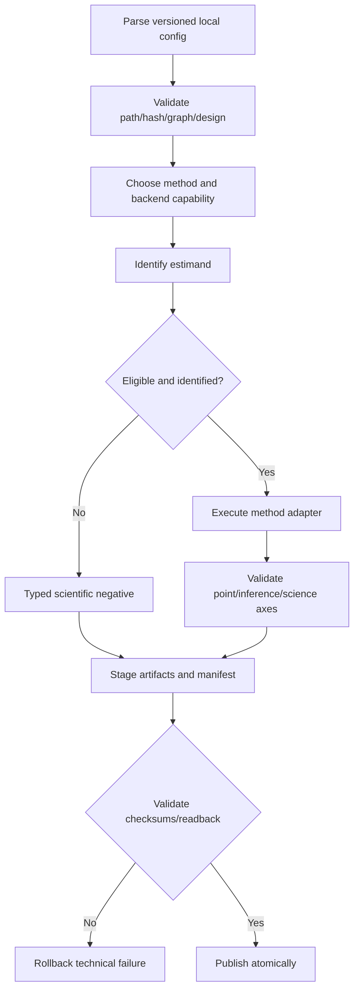

# 30.11 — ENH-E11 Proposed Physical Class and Module Design

**Status:** `PROPOSED / NOT_IMPLEMENTED / ADR_REVIEW_REQUIRED / CODING_NOT_AUTHORIZED`  
**Decision authority:** DEC-SR04-01〜09 approved *policy*, not exact physical signatures or JSON Schema. Everything below is a *candidate implementation contract*; the Python names, package paths and enum literals are not frozen.

## 1. Module layout (candidate, not existing code)

| Layer | Proposed package role | Permitted dependency | Forbidden dependency |
|---|---|---|---|
| Local Domain | `causal/local_contract/` | stdlib and immutable value types | DoWhy/EconML/Tigramite, Web, Product DB |
| Scientific Port | `causal/local_contract/ports/` | domain input/output types | framework-specific backend object |
| Scientific Adapters | `scientific/adapters/` | port/domain + optional engine | Persistent domain as raw engine return |
| Local Application | `causal/local_application/` | domain/ports | Browser navigation, Product DB lifecycle |
| CLI/Artifacts | `interfaces/cli/e11/` | local use cases, file adapters | Product Web/API schema changes |

Exact path choices must be checked against `src/ariadne/causal/`, `src/ariadne/scientific/`, `src/ariadne/interfaces/cli/` and the existing `ArtifactStorePort` before ADR freeze.

## 2. Candidate class/value contracts

All exposed field names below are **logical candidates**, not yet published Python fields or wire keys.

| Candidate symbol (layer) | Candidate fields / Python types | Public method signatures (proposed) | Invariant / failure | Verification |
|---|---|---|---|---|
| `LocalStudySpec` (domain, frozen value) | `schema_version: str`; `question_ref: ContentRef`; `design_ref: ContentRef`; `dataset_ref: ContentRef`; `graph_ref: ContentRef|None`; `analysis_mode: AnalysisMode` | `validate() -> None`; `canonical_payload() -> Mapping[str, JsonValue]` | Reject unknown schema, missing mandatory source, inconsistent content hashes; explicit version dispatcher | D04-T01, T03, T04 |
| `GraphEvidence` (domain, frozen value) | `kind: GraphKind`; `nodes: tuple[str,...]`; `edges: tuple[EndpointEdge,...]`; `parent_ref: ContentRef|None`; `provenance: Mapping[str,JsonValue]` | `validate_endpoints() -> None`; `new_revision(edit: GraphEdit) -> GraphEvidence` | No PAG→DAG coercion; preserve circle endpoints and lag; edit requires new version | GRAPH oracle, D06-T01〜T05 |
| `IdentificationOutcome` (domain) | `estimand: EstimandRef`; `status: IdentificationState`; `proof: ProofRef|None`; `reasons: tuple[Reason,...]`; `upstream_hashes: tuple[str,...]` | `is_eligible_for(request: EstimatorRequest) -> bool` | UNKNOWN/REQUIRES_REVIEW/nonidentified cannot auto-pass; separate evidence for future alternative proof | D04-T02, D06-T06 |
| `EstimatorRequest` (domain, frozen value) | `method: MethodId`; `estimand_family: EstimandFamily`; `design_ref: ContentRef`; `identification_ref: ContentRef`; `inference_mode: InferenceMode` | `validate_against(identification: IdentificationOutcome) -> None` | B0 LATE, B1 structural-IV and DRIV distinct; mismatch fails closed | DEC01/02, D04-T05 |
| `InferenceEvidence` (domain) | `status: Availability`; `confidence_set: ConfidenceSet|None`; `reason: Reason|None`; `method_config: Mapping[str,JsonValue]` | `validate_for(mode: AnalysisMode) -> None` | Confirmatory unsupported CI is not PASS; no fake SE/finite interval | D05-T01〜T13 |
| `ARConfidenceSet` (domain, frozen value) | `topology: SetTopology`; `components: tuple[Interval,...]`; `confidence_level: float`; `inversion_evidence: ContentRef` | `contains(beta: float) -> bool`; `to_canonical_payload() -> Mapping[str,JsonValue]` | Keep bounded/unbounded/disconnected/ALL_REAL, avoid spurious EMPTY for normal B0/B1; use explicit infinite endpoints | D03, D04-T07 |
| `EffectOutcome` (domain) | `estimand: EstimandRef`; `point: float|None`; `point_status: Availability`; `inference: InferenceEvidence`; `science_status: ScienceStatus`; `diagnostics: tuple[DiagnosticRef,...]` | `validate_consistency() -> None`; `serialize() -> Mapping[str,JsonValue]` | Point/uncertainty/science status are orthogonal; typed reason on null | D04 G2-Bridge, D05 |
| `BackendCapabilityRecord` (adapter output) | `method: MethodId`; `backend: str`; `effective_version: str|None`; `extra: str`; `availability: Availability`; `reason: Reason|None` | `require_compatible(spec: EstimatorRequest) -> None` | No silent substitute; version/API are effective runtime facts | DEC08 Runtime |
| `LocalRunManifest` (artifact value) | `manifest_version: str`; `input_hashes: Mapping[str,str]`; `output_hashes: Mapping[str,str]`; `backend_evidence: BackendCapabilityRecord`; `seed: int|None`; `split_ref: ContentRef|None`; `science_status: ScienceStatus` | `canonical_bytes() -> bytes`; `validate_references() -> None` | No implicit v2 manifest migration; actual versions/lock hash/readback | D04-M2, DEC08 |
| `LocalArtifactPublisher` (I/O adapter) | `root: Path`; `staging_root: Path`; `writer: ArtifactPort` | `stage(name: str, data: bytes) -> ArtifactRef`; `commit(manifest: LocalRunManifest) -> tuple[ArtifactRef,...]`; `rollback() -> None` | Reject traversal/symlink, invalid absolute paths, partial publish; atomicity must be specified over actual filesystem constraints | NFR-atomic/security |
| `E11CliUseCase` (application) | `identifier: IdentificationPort`; `estimators: EstimatorPort`; `capabilities: CapabilityPort`; `publisher: ArtifactPort` | `run(spec: LocalStudySpec) -> LocalExecutionOutcome` | Stage preflight→Identification→Eligibility→Estimator→Inference→Artifact; scientific negative is not technical exception | G01〜10, Gate06/07 |

**Typing note:** `ContentRef`, `JsonValue`, `Reason`, `MethodId`, `Availability`, `SetTopology` etc. are placeholders for explicitly versioned types. Do not introduce them as concrete code without ADR freeze. The class list describes a **candidate decomposition**, not a mandated new package duplication of existing ports.

## 3. Sequence / error semantics

**Technical vs scientific statuses:** Config/schema/path/security/backend-contract errors are technical or capability failures; nonidentification, invalid weak-IV assumptions, unsupported confirmatory CI, negative-control null are science/results statuses. Precise enum, exit category and exception hierarchy require interface review.

## 4. Method-specific implementation contracts to refine

| Method group | Required physical detail before Coding | Scientific negative |
|---|---|---|
| FD-A | Restricted linear/single-mediator estimator equations, DoWhy adapter calling convention, fixed DGP-005 | unidentified/frontdoor violation |
| FCI/Temporal | endpoint + time-lag serialization, CPDAG/PAG Oracle fidelity, library version mapping | unknown endpoint not converted to DAG |
| CATE/DRIV | Estimand-specific request, Method-specific inference registry, crossfit and Seed, support | weak/invalid IV, unsupported CI |
| B0/B1/AR | Wald ratio/2SLS formulas, robust covariance, set inversion/bracketing, unbounded union encoding | weak first stage, invalid IV, mismatched Estimand |
| DiD/Event/ITS/RD/SCM/SDID | family-specific design/estimator/inference/covariance and Reference oracle | pretrend/cluster, density manipulation, donor contamination |
| NCE/NCO/OLS RV | observed null-control source, classical OLS sensitivity exact q=1 computation | unsupported target estimator, invalid negative control |

## 5. Required ADR before class signatures are frozen

1. Reuse-vs-new decisions for `GraphVersion`, `ArtifactStorePort`, `CliManifest`; separate Product authority.
2. Explicit new schema/version IDs, enum values, JSON/Parquet field types, local file structure, point/typed set representation.
3. Provenance identity/canonicalization/digest, privacy, path security, atomic publish and rollback model.
4. Backend actual package API/versions/lock/extras and GPL conditional delivery restrictions.
5. Test-to-class trace: each public method with positive/negative unit tests, every scientific estimator with independent DGP/Reference/MC Gate evidence.

**Acceptance state:** `CLASS_CANDIDATE_DOCUMENTED`, not `ARCHITECTURE_APPROVED`, not `CODING_AUTHORIZED`.
