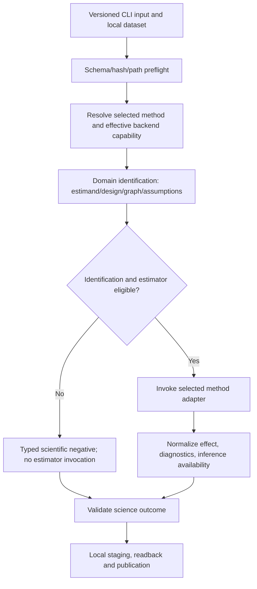

# 22_21 — ENH-E11 Scientific Pipeline / Eligibility / Method Boundaries

**State:** `BD01_REVISED_DESIGN / OWNER_ARCHITECTURE_POLICY_ACCEPTED / INDEPENDENT_REVIEW_PENDING / IF_DD_SCHEMA_UNFROZEN / NOT_IMPLEMENTED`  
**Date:** 2026-11-16. **Authority:** [DEC-SR04-09](../../../working_notes/20261116_sr04_dec09_scope_requirements_architecture_gate_integrated_owner_approval.md), [formal RD-03 trace](../../doc01_review/rd03_review/96_rd03_formal_requirement_traceability.md), [RD-04 audit](../../doc01_review/rd04_review/98_rd04_consistency_verification.md). 本文のPort名・層は論理的な責務名称であり実装済Class/Schemaを意味しない。

## 1. Logical execution and fail-closed gate

- **Malformed/unsafe input** はpreflightで拒否し、科学的な非識別とは区別する。
- **未識別・Review要・Estimator非適格**なら選択Estimatorを呼ばず、原因・仮定・入力/Graph参照を保持したscientific negativeを表現する。旧v2のoverrideを新E11へ暗黙継承しない。
- **Backend不在**は`METHOD_UNAVAILABLE`相当のCapability結果として扱う（具体codeはIF-01）。要求されたMethodを他Estimatorで代替して成功扱いしない。
- 点推定可能でも、**Confirmatory**で妥当な推論が無い場合はScience PASSではない。Exploratoryのpoint-onlyと区別する。
- Scientific negativeの正常記録と、I/O／計算／validationの技術障害は別の軸。Publish可否を`Execution success`という1つのbooleanに押し込めない。

## 2. Identification and Graph evidence

| Graph / evidence | Invariant / treatment |
|---|---|
| DAG | 指向辺の構造と仮定・versionを保持する |
| CPDAG | 向きの不確定な等価類をDAGとして捏造しない |
| PAG / FCI | endpoint circle/tail/arrow、潜在交絡に関する不確実性を保存し、無断DAG化しない |
| Latent MAG | Graph種別と潜在構造の解釈を区別し、PAGを特定MAGと自動同一視しない |
| Temporal | lag／same-time／direction／CI test条件を保存し、時間依存検証を省略しない |

- 修正Graphは**旧Version不変＋新Version/parent/edit rationale**とし、必ずIdentificationを再実行する。未確定Graphの方向を手で固定しただけで、未知の識別根拠があると主張しない。
- `Identification Outcome`はQuestion/Design/Estimand/Graph/Datasetのcontent identityと根拠・reasonsを保持。Estimator eligibilityはIdentification successとは別であり、Method support、instrument/mediator、sample/support、time structure、実効Backendを確認する。

## 3. Estimand / Method contract matrix

| Family | Initial target / design contract | Mandatory separation and limits | Trace |
|---|---|---|---|
| Baseline identification | Native Randomized／Backdoor、DoWhy Backdoor／Frontdoor／IV（各対応条件に限定） | Backdoor/IVの識別対象と利用者が指定したEstimandの対応を別途検査。DoWhyの内部`nonparametric-ate` labelをIV-LATEの証明とみなさない | FR-187, AR-029 |
| Baseline ATE/ATT estimation | diff-in-means、OLS、IPW、AIPW | Randomization/adjustment/overlap/weights、ATE/ATTの対象母集団、variance/CIをEstimator・構成ごとに区別 | FR-192, AR-033 |
| Refutation / Sensitivity | Placebo Treatment、Data Subset、Random Common Cause、Bootstrap、Adjustment Set、Propensity Clipping | どの科学仮説・上流Resultに対する反証か、random seed、再標本化・負例・Method制約を明示。単なる非有意を「頑健性証明」としない | FR-189, AR-044 |
| FD-A | 1 Mediator、承認済み限定線形FrontdoorによるATE数値推定 | Frontdoorの識別とモデル依存の2-stage estimationは別の成否／証拠 | FR-188, AR-030 |
| Observed Negative Control | 明示指定NCE/NCOとGraph・時間的適格性 | Null診断の非有意は無交絡の証明ではない；X-04の一般化はD | FR-190, AR-031 |
| OLS Unobserved Confounding | 古典OLS partial R²とpoint RV(q=1) | HC3推論への無検証転用、IPW/AIPW/CATE全面化不可 | FR-191, AR-032 |
| Weighted effect | IPW/IPTW/AIPWのATE/ATTと診断 | weight specification、normalization、clipping/trimming、overlap/balance/ESS/失効標本の区別 | FR-192, AR-033 |
| Non-IV CATE7 | LinearDML, CausalForestDML, DRLearner, ForestDRLearner, S/T/X-Learner | XとW、対象母集団、support；Method別CI availabilityを一括保証しない | FR-193, AR-034/035 |
| DRIV-A | 条件付きIV構造係数（IV_HETEROGENEOUS_EFFECT） | 非IV CATE、B0 complier LATE、将来の条件付きLATE estimator Cとは別 | FR-194, AR-034 |
| Temporal | PCMCI、PCMCI+、LPCMCIの承認済みscope | lag・endpoint・CI test適格性保持；RPCMCI/J-PCMCI+はD | FR-196, AR-036 |
| Time quasi-experiment | DiD、Event Study、ITS | 採用時期・parallel trends・cluster/autocorrelation・時点効果、Method別推論を区別 | FR-197, AR-037 |
| Threshold quasi-experiment | Sharp／Fuzzy RD | Cutoff、bandwidth、density、first-stage、局所IV Estimandを区別 | FR-198, AR-038 |
| IV-B0 | 単一二値Z/A、無調整のcomplier LATE | Wald/2SLSを承認済み比較として区別、IV仮定を検査 | FR-199, AR-039/040 |
| IV-B1 | 単一二値Z/A、事前指定Cを伴う加法線形IV構造係数 | B0や一般ATEと呼ばず、弱IVのAR反転に対応 | FR-199, AR-039/040 |
| SCM／SDID | donor-based counterfactual/DiD | SCM初期は**point-only**、未検証CI禁止。donor leakage／fit／期間を検査 | FR-200, AR-041 |

承認済みMethod一覧の**41件の義務とR/Q/N/Dの68 Scope**は [Scientific Method Scope](../10_requirements_definition/10_32_scientific_method_scope.md) がauthority。本表はMethod採用範囲を変更しない。

## 4. Scientific outcome design invariants

1. Technical execution outcome, identification state, point availability, uncertainty availability, scientific acceptance are **orthogonal axes**。Science不適格をI/O errorやゼロ値で置き換えない。
2. Weak-IVのAnderson–Rubin反転Confidence Setは`bounded`／`unbounded`／`disconnected`／`all real`を区別。承認済み正常なB0/B1のAR反転で`EMPTY`を通常形として出さない。Finite intervalへ丸めない。
3. CATE/DRIVはMethod・backend version・inference implementation・final model・nuisance・fold/seed/Bootstrapにより区間推論の妥当性が異なる。Backend標準出力を無条件に科学的受入しない。
4. Pointwise CIをsimultaneous confidence bandと呼ばない。推論無しならnull+typed reasonを保持。Exploratory point-onlyをConfirmatoryとして提供しない。
5. 研究者のoverrideは科学的な未識別を自動で打消さない。再識別・新GraphVersion・代替識別根拠が必要な場合はその手続き・provenanceを残す。

## 5. Verification boundary

Method-specific identification/eligibility、DGP/negative/reference、Graph/IV/CATE/Quasi inference、FS coverage testは未実施。前提条件の数値と有効なconfigはIF-01/Method-specific ADR/Gate07でFreeze。[BD-01 review](22_90_architecture_consistency_review.md)を参照。
